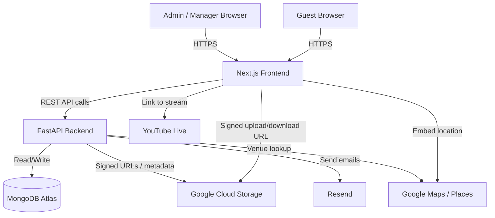

# Make My Marriage — Project Overview

> **Purpose:** This document provides a complete, consolidated overview of the Make My Marriage project for new developers and AI coding assistants. Read this document before making significant changes. For detailed specifications, consult the original source documents in `docs/`.

---

## Table of Contents

1. [Project Introduction](#1-project-introduction)
2. [Product Scope](#2-product-scope)
3. [User Roles and Permissions](#3-user-roles-and-permissions)
4. [Application Features and User Flows](#4-application-features-and-user-flows)
5. [Technology Stack](#5-technology-stack)
6. [System Architecture](#6-system-architecture)
7. [Database Overview](#7-database-overview)
8. [API Overview](#8-api-overview)
9. [Authentication, Security, and Privacy](#9-authentication-security-and-privacy)
10. [Project Structure](#10-project-structure)
11. [Environment Setup](#11-environment-setup)
12. [Deployment and Scalability](#12-deployment-and-scalability)
13. [Source Documents and Decision Notes](#13-source-documents-and-decision-notes)

---

## 1. Project Introduction

**Make My Marriage** is a reusable, multi-wedding website and management platform. A single platform instance supports multiple couples, each with their own isolated wedding website and management experience.

### The Problem It Solves

Planning a wedding involves coordinating events, managing a guest list, sending invitations, tracking RSVPs, sharing photographs, and providing venue and logistics information — all while keeping personal guest data private. Most solutions either require technical expertise to build a custom website or rely on generic tools that do not integrate these concerns.

Make My Marriage provides a purpose-built, administrator-controlled platform that handles all of this in one place.

### Main Objectives

- Provide a reusable wedding website template that multiple couples can use simultaneously.
- Allow a Platform Administrator to onboard Wedding Managers and set up wedding websites.
- Allow Wedding Managers to run day-to-day wedding operations from an authenticated dashboard.
- Allow guests to access wedding information and submit RSVPs **without creating an account**.
- Protect guest personal information and private wedding photographs.
- Deliver a simple, accessible, mobile-friendly experience suitable for people of all ages.

### Intended Users

| User | Description |
|------|-------------|
| **Platform Administrator** | Operates the platform; creates wedding websites and Manager accounts |
| **Wedding Manager** | Manages a specific wedding's events, guests, invitations, tasks, and photos |
| **Wedding Guest** | Views wedding information and submits RSVPs through a unique invitation link |

---

## 2. Product Scope

### 2.1 V1 MVP — In Scope

The following features are committed for Version 1:

1. Administrator and Wedding Manager authentication
2. Administrator-controlled Manager account creation and onboarding
3. Reusable wedding website template (multi-wedding support)
4. Wedding setup and personalized wedding details
5. Wedding Manager dashboard with summaries
6. Multiple wedding events and schedules
7. Task planner
8. Guest management (add, edit, remove, view)
9. Digital email invitations with unique guest tokens
10. RSVP management via token-based invitation links (Yes / No)
11. Email reminders for uninvited or non-responding guests
12. Private photo gallery (GCS-backed, short-lived signed URLs)
13. Wedding-specific QR codes linking to the public wedding website
14. Livestream information (optional; display/link only)
15. Role-based access control and wedding-level data isolation
16. Public wedding website (no login required for guests)

> **Note — Expense Tracker:** Although the SDD v1.2 and DBDD v1.0 include an expenses collection and related APIs, the README and scope notes confirm the Expense Tracker is **included in the technical data model** but explicitly **deferred from the V1 product UI scope**. The collection and API design exist in the specifications; the user-facing feature is not a V1 deliverable.

### 2.2 Explicitly Excluded from V1

- Budget management and expense tracking (UI feature — data model exists in specs)
- Guest login accounts
- Public photo galleries (galleries are private)
- Guest photo uploads
- WhatsApp notifications
- SMS notifications
- OTP verification (see Section 13 for details)
- Self-service public registration for Wedding Managers
- Multiple weddings per single Manager (unless introduced later)
- Built-in live-streaming infrastructure (display/link only)
- Advanced features not listed in the V1 scope

### 2.3 Future Enhancements (Not Committed)

- WhatsApp and SMS notifications
- Public or selectively shareable photo galleries
- Guest photo uploads
- Seating arrangements and table management
- Vendor management
- Budget and expense tracking (UI)
- Advanced wedding customization
- Multiple weddings per Manager
- Additional guest engagement features

---

## 3. User Roles and Permissions

### 3.1 Platform Administrator

The Platform Administrator is the top-level operational role.

**Responsibilities:**
- Create wedding websites
- Create Manager accounts and assign them to a wedding
- Configure initial wedding setup
- Oversee platform-level onboarding
- Review weddings and operations

**Authentication:** Must log in with valid credentials. Uses the shared `/login` page with a role-based redirect to `/admin`.

> **Open item:** The precise boundary between Platform Administrator and a wedding-level Admin supervisory role has not been finalized. See `SDD.doc` Section 4 and `README.md`.

### 3.2 Wedding Manager

The Wedding Manager handles day-to-day operations for their assigned wedding.

**Responsibilities:**
- Log in using credentials provided by the Platform Administrator
- Manage wedding details, schedules, and venue information
- Create and manage wedding events (Haldi, Mehendi, Sangeet, Ceremony, Reception, etc.)
- Create and track tasks with priorities and deadlines
- Add, edit, and remove guests
- Send digital email invitations and reminders
- View and manage RSVP responses
- Upload and organize wedding photographs (by album)
- Configure wedding location and QR code
- Add or update livestream details

**Authentication:** Must log in with valid credentials. Redirected to `/dashboard` after login. The backend must validate both role and wedding assignment for every protected operation.

**Restriction:** A Manager must not access another wedding's management data.

### 3.3 Wedding Guest

Guests do not create accounts and do not log in.

**Capabilities:**
- View the public wedding website (`/w/[slug]`) without any authentication
- View couple's names, wedding date, venue, and published events
- Open their unique invitation link (`/w/[slug]/invite/[token]`)
- Submit a Yes or No RSVP through their invitation link
- Access the private photo gallery when holding a valid invitation token authorized for that wedding
- View livestream information when available

**Restrictions:**
- Cannot access administrative dashboards
- Cannot view other guests' personal information (names, phone numbers, RSVP status)
- Cannot edit events, venues, or administrative records
- Cannot upload photos
- Cannot submit RSVPs without a valid invitation token

**Authentication:** None required for public pages. Guest-specific actions (RSVP, gallery) require a valid invitation token validated by the backend.

### 3.4 Permission Summary

| Capability | Platform Admin | Manager | Guest |
|---|---|---|---|
| Create wedding website | Yes | No | No |
| Create Manager account | Yes | No | No |
| Log in to dashboard | Yes | Yes | Not required |
| Review wedding information | Yes | Assigned wedding only | Public fields only |
| Manage events and tasks | Platform-level | Yes (assigned wedding) | No |
| Manage guests and invitations | Platform-level | Yes (assigned wedding) | Own invitation only |
| Submit RSVP | No | No | Yes, via unique link |
| Upload gallery photos | No (by default) | Yes | No |
| View authorized gallery | As permitted | Yes | Yes, if token is valid |
| View other guests' private data | Restricted | Assigned wedding only | No |

---

## 4. Application Features and User Flows

### 4.1 Wedding Setup and Management

The Platform Administrator creates a wedding record with:
- Couple names, slug (URL identifier), wedding date, timezone
- Venue name, address, and coordinates
- Welcome/description text
- Manager assignment

The wedding `slug` determines the public URL: `/w/[slug]`. The Manager can update permitted wedding fields from the dashboard.

**Public wedding page** (`/w/[slug]`) shows couple names, dates, venue, and published events to any visitor without requiring login.

### 4.2 Events and Task Planner

**Events** are individual wedding functions (Haldi, Mehendi, Sangeet, Wedding Ceremony, Reception, or custom). Each event has:
- Name, description
- Start and end time
- Venue name and address (with optional coordinates)
- `isPublic` flag controlling visibility on the guest-facing website

**Tasks** help the Manager organize wedding preparations. Each task has:
- Title and description
- Status: `pending`, `in_progress`, `completed`, `cancelled`
- Priority: `low`, `medium`, `high`
- Due date and optional assignee
- Created-by reference

The task planner is Manager-only; guests have no access to tasks.

### 4.3 Guest Management

The Manager maintains a guest list for their wedding. Each guest record holds:
- Name, email address (used for invitations), phone number
- Invitation status: `not_sent`, `sent`, `delivered`, `failed`, `revoked`

Guest contact details are private and must never be returned by public APIs or viewable by other guests.

### 4.4 Digital Invitations and Unique Invitation Links

When the Manager sends an invitation to a guest, the backend:
1. Generates a cryptographically secure, unique token
2. Stores the **hash** of the token (never the raw token) in the `invitations` collection
3. Sends an email (via Resend — proposed) containing the invitation link: `/w/[slug]/invite/[token]`

The raw token travels only in the email link and in the URL when the guest opens it. It is never logged, stored in plaintext, or exposed in API responses.

Tokens can be revoked, and replacement invitations can be sent. Invitation expiration policy is not yet finalized.

### 4.5 RSVP Submission and Management

**Guest RSVP flow (V1):**
1. Guest opens the invitation link `/w/[slug]/invite/[token]`
2. Backend validates the token, checks it has not been revoked, and identifies the associated guest and wedding
3. Guest sees a confirmation page with the wedding details and RSVP options
4. Guest selects Yes or No and submits
5. Backend creates or updates the guest's RSVP record (one record per guest per wedding)
6. Guest sees a success confirmation

> **No OTP in V1.** The PRD v1.0 described OTP verification for RSVP access. This requirement is **deferred**. V1 uses only the unique invitation token as authorization. See Section 13 for the full conflict note.

The Manager can view all RSVP responses and a summary (total guests, Yes, No, not responded) from the dashboard.

### 4.6 Wedding Website and QR Codes

Each wedding has a public website at `/w/[slug]` displaying:
- Couple names and welcome message
- Wedding date and general information
- Published event schedules and venues
- Venue location with map integration (Google Maps / Places — proposed)
- QR code link
- Livestream information (when available and permitted)

The QR code (`GET /api/v1/public/weddings/{slug}/qr`) encodes the public wedding URL. Scanning it opens the correct wedding website. The QR code does not contain invitation tokens or private information.

### 4.7 Private Photo Gallery

The Manager can upload photos to named albums. Photos are stored in **Google Cloud Storage**; MongoDB stores only the metadata (object key, album, file info, uploader).

**Guest access to the gallery (`/w/[slug]/gallery`):**
- The slug alone is **not sufficient** to grant gallery access
- The backend validates the guest's invitation token and confirms it is scoped to the correct wedding
- Only after successful authorization does the backend issue short-lived GCS signed URLs for the private photos
- Signed URLs expire after a configured lifetime
- Private photos must not have permanent public object URLs

> **Not yet implemented.** This authorization flow is the designed approach but is not part of the V1 scaffolding.

### 4.8 Livestream Information

The Manager can configure optional livestream details:
- Provider (e.g., `youtube`)
- URL (e.g., a YouTube Live link)
- Enabled/disabled flag

When enabled, the public wedding website displays the stream link. The platform links to the stream; it does not host a streaming service.

### 4.9 Email Notifications and Reminders

The Manager can send:
- Initial invitation emails (via Resend — proposed)
- RSVP reminder emails to guests who have not responded
- Event reminder emails
- Announcement emails

Each email includes relevant wedding information. Emails must not expose other guests' personal information. The `notifications` collection tracks delivery status.

WhatsApp and SMS notifications are excluded from V1.

---

## 5. Technology Stack

### 5.1 Confirmed Choices (verified from configuration files)

| Layer | Technology | Version / Detail |
|---|---|---|
| **Frontend framework** | Next.js (App Router) | `^15.0.0` (package.json) |
| **Frontend language** | TypeScript | `^5.0.0` |
| **Frontend runtime** | React | `^19.0.0` |
| **Frontend styling** | Vanilla CSS (design tokens in `globals.css`) | No CSS framework |
| **Frontend package manager** | npm | (package-lock.json present) |
| **Backend framework** | FastAPI | `>=0.115.0` (pyproject.toml) |
| **Backend language** | Python | `>=3.12` |
| **Backend ASGI server** | Uvicorn (standard extras) | `>=0.30.0` |
| **Backend package manager** | uv | (uv.lock and pyproject.toml) |
| **Database driver** | PyMongo Async (pymongo[asyncio]) | `>=4.9.0` |
| **Settings management** | pydantic-settings | `>=2.5.0` |
| **Media storage** | Google Cloud Storage | Confirmed via next.config.mjs remote image pattern (storage.googleapis.com) |

### 5.2 Proposed Integrations (documented but not yet configured)

| Service | Purpose | Decision Status |
|---|---|---|
| MongoDB Atlas | Managed cloud database | Proposed and expected; URI format confirmed in .env.example |
| Resend | Email invitations and reminders | Proposed (SDD v1.2 Section 2) |
| Google Maps / Places | Venue display and location | Proposed (SDD v1.2 Section 2) |
| YouTube Live | Optional livestream integration | Proposed (SDD v1.2 Section 2) |
| Google OAuth | Potential Admin/Manager authentication | Proposed; exact usage not finalized |

### 5.3 Infrastructure (Proposed, Not Finalized)

| Component | Option | Decision Status |
|---|---|---|
| Frontend hosting | Google Cloud Run or Google Cloud VM | Pending |
| Backend hosting | Google Cloud Run or Google Cloud VM | Pending |
| Load balancing | Google Cloud Load Balancer | Proposed; pending deployment decision |
| CDN | Google Cloud CDN | Optional; must not bypass private-gallery authorization |

### 5.4 Development Tools (verified from config files)

| Tool | Purpose |
|---|---|
| ESLint + eslint-config-next | Frontend linting |
| @types/node, @types/react, @types/react-dom | TypeScript type definitions |
| pytest + pytest-asyncio + httpx | Backend testing (pyproject.toml optional-dependencies) |
| hatchling | Backend build backend |

---

## 6. System Architecture

### 6.1 Logical Architecture

```
                        Users
                          |
           +--------------+--------------+
           |                             |
      Admin / Manager                 Guests
           |                             |
           +--------------+--------------+
                          |
                   Next.js Frontend
                          |
             [Google Cloud Load Balancer]
                   (if selected)
                          |
                  FastAPI Backend
                          |
          +---------------+----------------+
          |               |                |
   MongoDB Atlas   Google Cloud       External Services
   (app data)      Storage            - Resend (email)
                   (photos/media)     - Google Maps
                                      - YouTube Live
```

### 6.2 Architecture Diagram



### 6.3 Request and Data Flows

**Admin / Manager Dashboard flow:**
1. User navigates to `/login`, enters credentials
2. Frontend sends `POST /api/v1/auth/login` to FastAPI
3. FastAPI validates credentials against the `users` collection (hashed password check)
4. FastAPI establishes an authenticated session (mechanism not yet finalized)
5. Frontend redirects to `/admin` or `/dashboard` based on role
6. Subsequent dashboard API calls include the session credential
7. FastAPI validates the role and wedding assignment before returning data

**Guest RSVP flow:**
1. Guest opens `/w/[slug]/invite/[token]` from their email
2. Frontend sends the token to FastAPI for validation
3. FastAPI hashes the token, looks up the matching invitation, checks revocation/expiry
4. If valid, FastAPI returns the wedding and guest info
5. Guest selects Yes/No and submits the RSVP
6. FastAPI re-validates the token, upserts the RSVP record
7. Frontend shows a confirmation message

**Photo upload flow:**
1. Manager requests a signed upload URL from `POST /api/v1/weddings/{id}/photos/upload-url`
2. FastAPI validates Manager authorization, generates a short-lived GCS signed URL
3. Frontend uploads the file directly to GCS using the signed URL
4. Frontend calls `POST /api/v1/weddings/{id}/photos/complete` with the object key
5. FastAPI verifies the upload and saves photo metadata to MongoDB

**Private gallery access flow:**
1. Authorized guest opens `/w/[slug]/gallery` with their invitation token
2. FastAPI validates the token and confirms the guest's authorization for this specific wedding
3. FastAPI generates short-lived signed GCS URLs for the permitted photos
4. Frontend displays the photos; URLs expire after a configured period

---

## 7. Database Overview

The database is **MongoDB Atlas**. The driver is PyMongo Async (`pymongo[asyncio]`). All application data is stored in separate collections. Photo/media binaries are stored in Google Cloud Storage; MongoDB stores only the metadata.

### 7.1 Collections Summary

| Collection | Purpose |
|---|---|
| `users` | Authenticated platform users: Platform Admin and Wedding Managers. Stores hashed passwords, role, and wedding assignment. |
| `weddings` | Wedding configuration: couple names, slug, dates, venue, location, manager assignments, livestream config, status. |
| `events` | Wedding functions and schedules, each belonging to one wedding. Includes an `isPublic` flag. |
| `tasks` | Wedding planning tasks with status, priority, due date, and assignee. Manager-only access. |
| `expenses` | Wedding expense records. Uses Decimal128 for monetary amounts. Manager-only access. |
| `guests` | Guest contact details (name, email, phone) and invitation status. Private; never returned by public APIs. |
| `invitations` | One invitation record per guest, storing the **token hash** (not the raw token), status, and timestamps. |
| `rsvps` | One RSVP record per guest per wedding. Response is `yes` or `no`. References the invitation used. |
| `photoAlbums` | Album metadata: title, description, `accessType` (public or authorized_guests). |
| `photos` | Photo metadata: GCS object key, filename, MIME type, size, uploader. Photo binaries are in GCS. |
| `notifications` | Email delivery history: type (invitation / reminder), status, provider message ID. |

### 7.2 Key Relationships

- **`weddings` is the root** — Every wedding-specific record (`events`, `tasks`, `expenses`, `guests`, `photoAlbums`, `notifications`) carries a `weddingId`. All backend queries must scope by `weddingId` derived from the authenticated user's permissions, never from untrusted client input.
- **`guests` → `invitations`** — One guest can have multiple invitation records over time (e.g., if a link is revoked and re-issued).
- **`invitations` → `rsvps`** — An RSVP references the invitation through which it was submitted.
- **`photoAlbums` → `photos`** — Each photo belongs to one album and one wedding.
- **`users.weddingId`** — Assigns a Manager to a wedding. Platform Administrator accounts may have no wedding assignment.

### 7.3 Data Isolation Principle

The backend must derive or validate `weddingId` from the authenticated user session or a validated guest invitation token. The backend must **never trust a `weddingId` supplied by the frontend** without verifying authorization. This prevents cross-wedding data leakage.

> Refer to `docs/DBDD.doc` for complete field definitions, index design, example documents, validation rules, and data lifecycle policies.

---

## 8. API Overview

### 8.1 Versioning and Base URL

All API endpoints are versioned under `/api/v1`.

| Environment | Base URL |
|---|---|
| Local development | `http://localhost:8000/api/v1` |
| Production | Not yet finalized |

Interactive documentation is auto-generated by FastAPI at:
- Swagger UI: `/api/docs`
- ReDoc: `/api/redoc`
- OpenAPI JSON: `/api/openapi.json`

### 8.2 Standard Response Shape

**Success:**
```json
{
  "success": true,
  "message": "Human-readable message",
  "data": { }
}
```

**Error:**
```json
{
  "success": false,
  "error": {
    "code": "VALIDATION_ERROR",
    "message": "The request contains invalid data",
    "details": [{ "field": "startTime", "message": "A valid start time is required" }]
  }
}
```

### 8.3 API Groups

| Group | Prefix | Authentication | Description |
|---|---|---|---|
| Health | `/api/v1/health` | None | Server liveness check |
| Authentication | `/api/v1/auth/` | Mixed | Login, logout, current user, password reset |
| Platform Admin | `/api/v1/admin/` | Platform Admin | Create weddings, create/manage Manager accounts |
| Wedding Management | `/api/v1/weddings/{weddingId}/` | Admin or Manager | Dashboard, events, tasks, expenses, guests, invitations, reminders, photos, location, livestream |
| Public Wedding | `/api/v1/public/weddings/{slug}/` | None | Public wedding details, events, location, QR code, gallery (authorized), livestream |
| Invitations / RSVP | `/api/v1/invitations/` | Invitation token | Token validation, RSVP submission |

### 8.4 Currently Implemented Endpoints

| Method | Endpoint | Status |
|---|---|---|
| `GET` | `/api/v1/health` | Implemented |

All other endpoints described in `API-DD.doc` are **not yet implemented**.

> Refer to `docs/API-DD.doc` for detailed endpoint specifications, request/response schemas, HTTP status code usage, validation rules, and the complete testing strategy.

---

## 9. Authentication, Security, and Privacy

### 9.1 Admin and Manager Authentication

- Both Admin and Manager authenticate through a shared login page (`/login`)
- Credentials are validated by FastAPI against the `users` collection
- Passwords are **never stored in plaintext**; they must be securely hashed
- On successful login, the backend establishes an authenticated session
- The exact mechanism (HTTP-only secure cookie vs. bearer token) **has not been finalized**
- The backend must invalidate the session on logout

### 9.2 Guest Access and Invitation Token Behavior

- Guests do **not** log in or create accounts
- The public wedding website (`/w/[slug]`) is accessible to any visitor
- For guest-specific actions (RSVP, gallery), the backend validates the **invitation token** sent in the URL
- Token validation steps:
  1. The backend hashes the submitted token and looks up the matching `invitations` record
  2. It checks the token's status (must not be `revoked` or `expired`)
  3. It confirms the token belongs to the correct wedding
  4. Only then does it allow the protected action
- Tokens are generated using a **cryptographically secure random generator**
- Only the **hash** of the token is stored in MongoDB; the raw token exists only in the email link
- Raw tokens must never appear in application logs, analytics events, or API responses

### 9.3 Guest Privacy

- Guest phone numbers, email addresses, full guest lists, invitation token hashes, and private RSVP records must **never be returned by public APIs**
- Guests can only access their own RSVP information (the token scopes the request to a single guest)
- Gallery access requires a valid invitation token — the wedding slug alone is insufficient

### 9.4 Private Gallery Authorization

- Photos are stored in a **non-public** GCS bucket
- The backend generates **short-lived signed URLs** only after confirming the guest's invitation token is valid and authorized for that specific wedding
- A guest from Wedding A cannot access Wedding B's gallery
- Signed URLs expire; guests cannot reuse them indefinitely

### 9.5 Wedding-Level Data Isolation

- Every backend query against wedding-specific data must include a `weddingId` check derived from the authenticated user's session
- A Manager's requests are scoped to their assigned wedding; the backend enforces this on every operation
- Manipulating an ID in a request must not bypass authorization

### 9.6 General Security Principles

- HTTPS required in production
- CORS configured in the backend (`CORS_ORIGINS` environment variable)
- Sensitive fields (passwords, token hashes) are never returned by any API
- Rate limiting on sensitive public endpoints (invitation token validation, login)
- Error responses must not reveal whether a specific email or username exists

---

## 10. Project Structure

The following is the actual directory tree as of the initial scaffolding. Route-level subdirectories listed in `README.md` (`/admin`, `/dashboard`, `/login`, `/w/[slug]`) are planned but **do not yet exist** in the file system.

```
make-my-marriage/
├── .agents/                        # Workspace-level agent customizations
├── .git/                           # Git repository
├── .gitignore
├── README.md                       # Project README with architecture and setup instructions
│
├── docs/                           # Source-of-truth specification documents (do not modify)
│   ├── PRD.doc                     # Product Requirements Document v1.0
│   ├── SDD.doc                     # System Design Document v1.2
│   ├── DBDD.doc                    # Database Design Document v1.0
│   ├── API-DD.doc                  # API Design Document v1.0
│   ├── PROJECT_OVERVIEW.md         # This file
│   └── DEVELOPMENT_PROGRESS.md    # Development tracking document
│
├── frontend/                       # Next.js application (App Router, TypeScript, Vanilla CSS)
│   ├── .env.example                # Environment variable template
│   ├── .env.local                  # Local environment variables (not committed)
│   ├── .next/                      # Next.js build output (generated)
│   ├── next-env.d.ts               # Next.js TypeScript declarations (generated)
│   ├── next.config.mjs             # Next.js configuration (GCS remote image patterns)
│   ├── node_modules/               # Installed npm dependencies
│   ├── package.json                # npm dependencies and scripts
│   ├── package-lock.json           # Locked dependency versions
│   ├── tsconfig.json               # TypeScript configuration
│   └── src/
│       └── app/                    # Next.js App Router root
│           ├── globals.css         # Global CSS design tokens and base styles
│           ├── layout.tsx          # Root layout component (sets metadata and body)
│           └── page.tsx            # Homepage placeholder
│
└── backend/                        # FastAPI application (Python 3.12, uv)
    ├── .env                        # Local environment variables (not committed)
    ├── .env.example                # Environment variable template
    ├── .venv/                      # Python virtual environment (managed by uv)
    ├── pyproject.toml              # Project metadata and dependencies
    ├── uv.lock                     # Locked Python dependency versions
    └── app/
        ├── main.py                 # FastAPI app factory, CORS middleware, health endpoint
        ├── core/
        │   └── config.py           # Pydantic Settings: reads env vars at startup
        └── db/
            └── session.py          # PyMongo Async client lifecycle (lifespan_db, get_database)
```

### Key File Purposes

| File | Purpose |
|---|---|
| `frontend/src/app/globals.css` | Defines the complete CSS design token system (colors, typography, spacing, shadows, transitions) |
| `frontend/src/app/layout.tsx` | Root Next.js layout; sets page title and description metadata |
| `frontend/src/app/page.tsx` | Homepage placeholder component; displays "Make My Marriage" heading |
| `frontend/next.config.mjs` | Configures `storage.googleapis.com` as an allowed remote image host |
| `backend/app/main.py` | Creates the FastAPI instance, configures CORS, mounts the health check endpoint, wires `lifespan_db` |
| `backend/app/core/config.py` | Validates all required environment variables at startup using pydantic-settings |
| `backend/app/db/session.py` | Opens and closes the PyMongo Async client connection pool; provides `get_database()` for dependency injection |

---

## 11. Environment Setup

### 11.1 Prerequisites

| Requirement | Version | Notes |
|---|---|---|
| Node.js | 20+ | Required for Next.js 15 |
| npm | Bundled with Node.js | Used for frontend dependency management |
| Python | 3.12+ | Required by pyproject.toml |
| uv | Latest | Python package and venv manager; must be installed separately |
| MongoDB Atlas | Any | A cluster URI is required; local MongoDB can be substituted for development |

### 11.2 Frontend Setup

```bash
cd frontend
npm install          # Install dependencies (node_modules exists but verify)
npm run dev          # Start the Next.js development server on port 3000
```

Copy the environment template and configure:
```bash
cp .env.example .env.local
# Edit .env.local and set:
# NEXT_PUBLIC_API_BASE_URL=http://localhost:8000
```

**`frontend/.env.example` variables:**

| Variable | Description | Default |
|---|---|---|
| `NEXT_PUBLIC_API_BASE_URL` | Base URL of the FastAPI backend | `http://localhost:8000` |

### 11.3 Backend Setup

```bash
cd backend
uv venv              # Create the virtual environment in .venv/
uv pip install -e .  # Install dependencies from pyproject.toml
uvicorn app.main:app --reload  # Start the development server on port 8000
```

Copy the environment template and configure:
```bash
cp .env.example .env
# Edit .env with real values (never commit .env)
```

**`backend/.env.example` variables:**

| Variable | Description | Example |
|---|---|---|
| `MONGODB_URI` | MongoDB Atlas connection string | `mongodb+srv://...` |
| `DATABASE_NAME` | Database name for this environment | `make-my-marriage-dev` |
| `SECRET_KEY` | Secret key for signing tokens/sessions | Long random string |
| `CORS_ORIGINS` | Comma-separated list of allowed frontend origins | `http://localhost:3000` |

> **Not yet verified:** Backend startup with a real MongoDB Atlas connection has not been confirmed. See `docs/DEVELOPMENT_PROGRESS.md` for current verification status.

### 11.4 Verification Checklist

| Check | Command | Expected result |
|---|---|---|
| Frontend starts | `npm run dev` (in `frontend/`) | Next.js dev server on port 3000 |
| Backend starts | `uvicorn app.main:app --reload` (in `backend/`) | Uvicorn listening on port 8000 |
| Health endpoint responds | `curl http://localhost:8000/api/v1/health` | `{"status": "ok"}` |
| API docs accessible | Open `http://localhost:8000/api/docs` | Swagger UI |

---

## 12. Deployment and Scalability

### 12.1 Documented Hosting Direction

| Component | Documented Direction | Decision Status |
|---|---|---|
| Frontend hosting | Google Cloud Run or Google Cloud VM | **Pending** |
| Backend hosting | Google Cloud Run or Google Cloud VM | **Pending** |
| Database | MongoDB Atlas managed cloud | Confirmed direction |
| Media storage | Google Cloud Storage | Confirmed direction |
| Load balancing | Google Cloud Load Balancer | Proposed; pending deployment decision |
| CDN | Google Cloud CDN | Optional; must not allow private media to be cached unsafely |

### 12.2 Scale Estimate

The SDD v1.2 provides a planning estimate of **fewer than 10,000 guests** across the platform. This is not a finalized capacity commitment. Load testing should establish actual targets before production.

### 12.3 Performance Considerations (from SDD v1.2)

- Index frequently queried MongoDB fields (see DBDD.doc Section 6)
- Paginate guest lists, task lists, and photo collections
- Store images in GCS rather than MongoDB
- Generate thumbnails and optimized image sizes where appropriate
- Keep private gallery authorization checks active even when a CDN is used

### 12.4 Open Deployment Decisions

The following deployment decisions have not yet been finalized:
- Cloud Run versus Compute Engine VM
- Whether a Google Cloud Load Balancer is needed
- Whether Google Cloud CDN is needed and how private content will be excluded
- Custom domain and final URL structure
- Development, testing, and production environment definitions
- Secret management, monitoring, and backup configuration

---

## 13. Source Documents and Decision Notes

### 13.1 Source Documents

| File | Version | Description |
|---|---|---|
| `docs/PRD.doc` | v1.0 | Product Requirements Document — features, user roles, V1 scope |
| `docs/SDD.doc` | v1.2 | System Design Document — architecture, tech stack, data model, implementation order |
| `docs/DBDD.doc` | v1.0 | Database Design Document — collection schemas, indexes, validation, security, lifecycle |
| `docs/API-DD.doc` | v1.0 | API Design Document — endpoint specifications, request/response schemas, security rules |

### 13.2 Specification Precedence

Where the source documents disagree, the later technical specifications (SDD v1.2, DBDD v1.0, API-DD v1.0) **supersede** PRD v1.0 for implementation purposes. This is documented in `README.md`.

### 13.3 OTP Requirement — Documented Conflict and Resolution

**PRD v1.0, Section 5.9** describes SMS/phone OTP verification for guests accessing or updating RSVP information.

**SDD v1.2, DBDD v1.0, and API-DD v1.0** explicitly exclude guest accounts, guest login, and OTP verification from V1.

**Confirmed V1 decision (recorded in `README.md`):** OTP is **deferred to a future release**. Guests in V1 identify themselves exclusively through cryptographic unique invitation tokens delivered via email (`/w/[slug]/invite/[token]`). No account creation, phone number verification, or OTP is required.

**Do not implement OTP as part of V1 development.**

### 13.4 Expense Tracker — Documented Conflict and Resolution

**PRD v1.0, Section 5.5** notes "Budget and expense tracking are not part of this module in Version 1."

**SDD v1.2 and DBDD v1.0** include an `expenses` collection and related API endpoints in the technical specification.

**Confirmed V1 decision (recorded in `README.md`):** The Expense Tracker **UI feature is deferred from V1 product scope**. The data collection and API design exist in the specifications and can be implemented in the backend for completeness, but the user-facing expense management interface is not a V1 deliverable.

### 13.5 Admin Role Boundary — Open Item

The SDD v1.2 describes two supervisory levels: Platform Administrator and wedding-level Admin. The precise boundary of editing versus supervisory permissions for the Admin role has **not been finalized**. Consult with the project owner before implementing Admin-specific permissions beyond what is clearly defined.

### 13.6 Additional Open Items (from SDD v1.2 and API-DD v1.0)

- Exact authentication mechanism and session/token configuration
- Password reset and account activation flow
- Invitation expiration and replacement policy
- Guest gallery access when a guest loses their invitation link
- Whether guest email addresses are mandatory or optional
- Final production domain and URL structure
- Monitoring, backup frequency, and recovery targets
