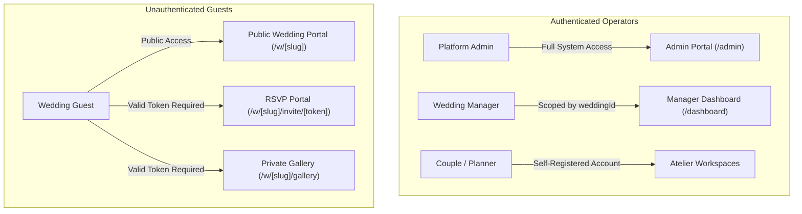
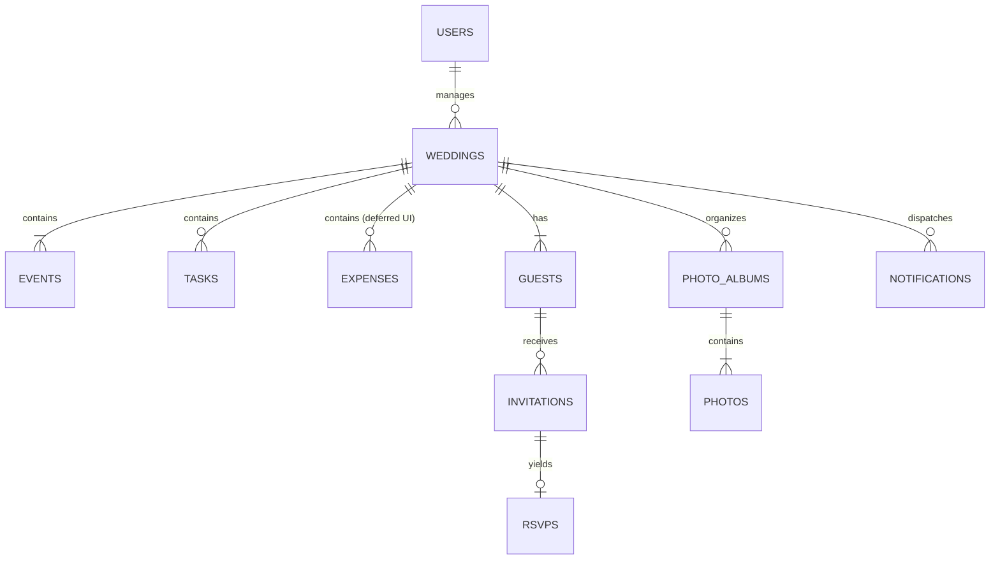

# Make My Marriage — Project Overview

> **Document Type:** Technical & Architectural Reference  
> **Target Audience:** Software Engineers, System Architects, and Technical Contributors joining Make My Marriage  
> **Last Updated:** 2026-10-28  
> **Implementation Baseline:** Dev Branch (Full-Stack Authentication & Editorial Scaffolding Verified)

---

## Table of Contents

1. [Project Introduction](#1-project-introduction)
2. [Project Scope and Main Features](#2-project-scope-and-main-features)
3. [User Roles and Access Model](#3-user-roles-and-access-model)
4. [Technology Stack](#4-technology-stack)
5. [System Architecture](#5-system-architecture)
6. [Frontend Architecture](#6-frontend-architecture)
7. [Backend Architecture](#7-backend-architecture)
8. [Database Design and Data Management](#8-database-design-and-data-management)
9. [Servers, Hosting, and Infrastructure](#9-servers-hosting-and-infrastructure)
10. [API Architecture](#10-api-architecture)
11. [Security, Privacy, and Data Isolation](#11-security-privacy-and-data-isolation)
12. [Configuration and Environment Variables](#12-configuration-and-environment-variables)
13. [Repository Structure](#13-repository-structure)
14. [Local Development Setup](#14-local-development-setup)
15. [Current Limitations and Technical Decisions](#15-current-limitations-and-technical-decisions)

---

## 1. Project Introduction

**Make My Marriage** is a bespoke, multi-tenant digital wedding website and event management platform. Built to serve modern couples, luxury wedding concierges, and boutique wedding ateliers, a single deployment of Make My Marriage powers multiple distinct weddings, each maintaining strict logical isolation, customizable schedules, guest records, and media galleries.

### The Problem It Solves

Organizing high-end weddings requires orchestrating complex event timelines (e.g., Haldi, Mehendi, Sangeet, Ceremony, Reception), coordinating guest lists, dispatching personalized invitations, aggregating RSVPs, and curating photo albums. Generic event platforms lack dedicated Indian and multi-event wedding structures, whereas bespoke single-use wedding websites require redundant engineering, expensive custom hosting, and offer poor guest privacy.

Make My Marriage delivers an all-in-one, reusable, administrator-controlled platform that combines an editorial visual aesthetic with multi-event scheduling, frictionless guest RSVP workflows, and private media distribution.

### Core Goals & Intended Benefits

- **Multi-Wedding Reusability:** One platform instance hosts multiple weddings with isolated data boundaries (`weddingId`).
- **Frictionless Guest Experience:** Guests view wedding details and respond to RSVPs **without creating accounts, remembering passwords, or completing SMS/OTP verifications**.
- **Privacy by Design:** Guest contact information, RSVP statuses, and intimate wedding photographs remain strictly confidential and are never exposed via unauthenticated public endpoints.
- **Editorial Brand Aesthetic:** An editorial haute couture visual identity using curated palettes (gold, burgundy, slate charcoal), classic serif typography, and responsive split-screen layouts.
- **Operational Clarity:** Dedicated authenticated dashboards for Platform Administrators and Wedding Managers to track real-time planning progress, guest confirmations, and logistics tasks.

### Architecture Classification

Make My Marriage is explicitly a **reusable multi-wedding platform**, not a single-wedding website. While visitors navigate to individual public wedding portals via slug-based URLs (`/w/[slug]`), all backend models, queries, and storage buckets enforce multi-tenant separation.

---

## 2. Project Scope and Main Features

### 2.1 Core Functional Modules (Approved V1 MVP Scope)

| Feature Module | Intended Product Scope | Implementation Status |
|---|---|---|
| **Platform Admin Management** | Super-admin provisioning of wedding records, manager assignment, and platform oversight. | **Planned** (Endpoints designed in `API-DD.md`; UI pending) |
| **Wedding Manager Dashboard** | Central operational dashboard (`/dashboard`) summarizing guest headcounts, RSVP tallies, pending tasks, and event milestones. | **Planned** (Endpoints designed; UI pending) |
| **Wedding Website Setup** | Configuration of couple names, wedding date, venue coordinates, timezone, welcome narrative, and custom URL slug. | **Planned** (Endpoints designed; UI pending) |
| **Wedding Events & Schedules** | Timeline management of multiple sub-events (Haldi, Mehendi, Sangeet, Ceremony, Reception) with individual start/end times and public visibility flags. | **Planned** (Endpoints designed; UI pending) |
| **Task Planner** | Operational preparation tracker with priorities (`low`, `medium`, `high`), due dates, assignee tagging, and statuses (`pending`, `completed`). | **Planned** (Endpoints designed; UI pending) |
| **Guest Management** | Comprehensive guest list directory with contact details (email, phone) and invitation tracking statuses (`not_sent`, `sent`, `delivered`, `failed`). | **Planned** (Endpoints designed; UI pending) |
| **Digital Invitations** | Automated dispatch of personalized digital invitation emails via Resend containing unique, single-use cryptographic invitation tokens. | **Planned** (Service integration pending) |
| **RSVP Management** | Token-authorized RSVP confirmation (`/w/[slug]/invite/[token]`) enabling one-click Yes/No responses without login. | **Planned** (Endpoints designed; UI pending) |
| **QR Code Generation** | Dynamic generation of QR codes directing guests to the public wedding website URL (`/w/[slug]`). | **Planned** (Library selection pending) |
| **Private Photo Gallery** | Secure album-based photo display backed by Google Cloud Storage, accessed strictly via short-lived signed URLs. | **Planned** (GCS bucket and signing service pending) |
| **Livestream Integration** | Optional embed or external redirect link (e.g., YouTube Live) for remote wedding attendees. | **Planned** (Data schema ready; UI pending) |
| **Authentication & Accounts** | Multi-role user registration (`/signup`), credential authentication (`/login`), session verification (`/api/v1/auth/me`), and secure logout (`/logout`). | **Implemented & Verified** (Backend endpoints and frontend split-screen UI fully functional) |

### 2.2 Features Explicitly Excluded from V1 Release Scope

To maintain engineering focus and adhere to approved design documents (`README.md`, `SDD.md`, `DBDD.md`, `API-DD.md`), the following items are **explicitly excluded** from the V1 release:

1. **Expense Tracker UI:** While an `expenses` collection schema exists in `DBDD.md` for technical schema completeness, the user-facing Expense Tracker interface is **deferred from V1 scope**.
2. **Guest Login & Account Creation:** Wedding guests never register an account or create passwords.
3. **SMS / Phone OTP Verification:** PRD v1.0 Section 5.9 described phone OTP for RSVPs. This was officially **superseded and deferred** in SDD v1.2, DBDD v1.0, and API-DD v1.0 in favor of cryptographic token links (`/w/[slug]/invite/[token]`).
4. **Public Photo Galleries:** Photo galleries are never publicly indexable; access requires an authorized guest invitation token.
5. **Guest Photo Uploads:** Guests cannot upload images in V1; photo curation is restricted to Wedding Managers.
6. **WhatsApp & SMS Notifications:** Automated messaging is restricted to email in V1; SMS/WhatsApp gateways are planned for future phases.
7. **Custom Video Streaming Infrastructure:** Make My Marriage does not host video streams; it provides external stream links.

---

## 3. User Roles and Access Model

The platform enforces a strict separation between authenticated operators and unauthenticated wedding guests.



### 3.1 Platform Administrator
- **Authentication:** Authenticates with email and password via `/login`.
- **Scope:** Global platform visibility.
- **Responsibilities:** Provisions new wedding instances, creates Wedding Manager accounts, links managers to weddings, and monitors platform-wide system health.

### 3.2 Wedding Manager
- **Authentication:** Authenticates with credentials via `/login`.
- **Scope:** Strictly scoped to their assigned `weddingId`.
- **Responsibilities:** Configures venue details, schedules events, tracks tasks, maintains the guest roster, initiates invitation dispatches, monitors RSVP counts, and uploads gallery photos.
- **Data Isolation:** Backend queries automatically filter by `weddingId` derived from the validated session. Cross-wedding access attempts return `HTTP 403 Forbidden`.

### 3.3 Marrying Couple & Wedding Planner
- **Authentication:** Self-service registration via `/signup` with role tags `couple` or `planner`, authenticating via `/login`.
- **Scope:** Assigned wedding workspace upon wedding provisioning.
- **Responsibilities:** Collaborate with concierges on design preferences, review timelines, and preview guest invitations.

### 3.4 Wedding Guest
- **Authentication:** **None.** Guests do not create accounts, set passwords, or log in.
- **Public Access:** Any guest or visitor can access public wedding pages (`/w/[slug]`) to view couple details, event schedules, venue locations, and livestream links.
- **Protected Actions:**
  - **Submitting RSVPs:** Accessible only through unique invitation links containing a cryptographic token: `/w/[slug]/invite/[token]`.
  - **Viewing Private Galleries:** Accessible at `/w/[slug]/gallery` only when accompanied by a valid, non-revoked guest invitation token scoped to that wedding.
- **Privacy Protections:** Guests can never view other guests' names, contact numbers, or response statuses.

---

## 4. Technology Stack

### 4.1 Technology Inventory

| Layer | Technology | Purpose | Actual Status | Codebase Evidence |
|---|---|---|---|---|
| **Frontend Framework** | Next.js 15.0.0 (App Router) | Server-side rendering, client routing, and UI layout | **Implemented** | `frontend/package.json`, `frontend/src/app/` |
| **Frontend Language** | TypeScript 5.0.0 | Static type safety and strict schema checking | **Implemented** | `frontend/tsconfig.json` |
| **Frontend Styling** | Tailwind CSS 3.4.19 + Vanilla CSS Tokens | Editorial design tokens, typography, and responsive layouts | **Implemented** | `frontend/tailwind.config.js`, `frontend/src/app/globals.css`, `frontend/src/app/stitch.css` |
| **Typography** | `next/font/google` | Zero-layout-shift Google fonts (`Cinzel`, `Playfair Display`, `Plus Jakarta Sans`) | **Implemented** | `frontend/src/app/layout.tsx` |
| **Frontend Package Manager** | npm | Frontend dependency management | **Implemented** | `frontend/package-lock.json` |
| **Backend Framework** | FastAPI 0.115.0+ | Asynchronous REST API, routing, and OpenAPI documentation | **Implemented** | `backend/pyproject.toml`, `backend/app/main.py` |
| **Backend Language** | Python 3.12+ | Server-side programming and business logic | **Implemented** | `backend/pyproject.toml` (`requires-python = ">=3.12"`) |
| **Backend ASGI Server** | Uvicorn 0.30.0+ | Asynchronous server execution | **Implemented** | `backend/pyproject.toml` |
| **Database** | MongoDB Atlas | Flexible document storage for multi-event wedding records | **Configured & Verified** | Live Atlas cluster connected; `users` collection verified via `ping` |
| **Database Driver** | PyMongo 4.9.0+ (`pymongo[asyncio]`) | Asynchronous non-blocking MongoDB communication | **Implemented** | `backend/app/db/session.py` (`AsyncMongoClient`) |
| **Backend Package Manager** | uv | Fast Python virtual environment and dependency locking | **Implemented** | `backend/uv.lock`, `backend/pyproject.toml` |
| **Media Storage** | Google Cloud Storage (GCS) | Encrypted, private storage of high-resolution wedding photos | **Planned** | Configured in `next.config.mjs` remote patterns; GCS SDK not yet integrated |
| **Email Service** | Resend | Transactional dispatch of invitation emails with secure tokens | **Planned** | Documented in SDD v1.2; API client not yet integrated |
| **Testing** | pytest 8.0+, pytest-asyncio, httpx, ESLint | Unit, cryptographic, schema, and health testing | **Implemented** | `backend/tests/` (10/10 tests passing); `frontend/eslint.config.mjs` (0 errors) |
| **Hosting & Deployment** | Google Cloud Run / Compute Engine | Cloud application hosting and managed scaling | **Planned** | Proposed in SDD v1.2; local development verified on ports 3000 & 8000 |

### 4.2 Technology Justifications & Responsibilities

- **Next.js 15 (App Router):** Provides server rendering for public wedding SEO, fast client-side navigation for dashboards, and automatic image optimization via `<Image />`.
- **FastAPI (Python 3.12):** Offers native asynchronous I/O matching MongoDB's async driver, automatic request validation via Pydantic, and self-documenting OpenAPI endpoints (`/api/docs`).
- **MongoDB Atlas & PyMongo Async:** Schema flexibility is ideal for multi-cultural wedding events with diverse attributes (Haldi ceremonies, Sangeet schedules, custom dietary preferences) while supporting rapid indexing on `weddingId`, `email`, and `tokenHash`.
- **Google Cloud Storage (Planned):** Prevents binary bloat inside MongoDB. Photos remain encrypted at rest in private buckets, exposed only via temporary pre-signed URLs.

---

## 5. System Architecture

The following diagram illustrates the verified local development architecture alongside the planned cloud production services:

```mermaid
graph TD
    subgraph Client Layer
        Browser[Client Browser / Mobile Device]
    end

    subgraph Frontend [Next.js 15 App Router - Port 3000]
        LP["Landing Page (/)"]
        AuthUI["Login & Signup (/login, /signup)"]
        DashUI["Dashboards (/admin, /dashboard) [Planned]"]
        PublicUI["Public Wedding (/w/[slug]) [Planned]"]
    end

    subgraph Backend [FastAPI Backend - Port 8000]
        Main["FastAPI Entrypoint (app/main.py)"]
        AuthRouter["Auth Router (/api/v1/auth)"]
        AdminRouter["Admin Router (/api/v1/admin) [Planned]"]
        WeddingRouter["Wedding Router (/api/v1/weddings) [Planned]"]
        PublicRouter["Public Router (/api/v1/public) [Planned]"]
        Security["Crypto: PBKDF2 & HMAC (app/core/security.py)"]
        DBSession["PyMongo Async Client (app/db/session.py)"]
    end

    subgraph Data & Cloud Services
        Atlas[("MongoDB Atlas Cloud (make-my-marriage-dev) [Verified]")]
        GCS["Google Cloud Storage [Planned]"]
        Resend["Resend Transactional Email [Planned]"]
    end

    Browser -->|HTTP 3000| Frontend
    Frontend -->|REST API / Cookies (Port 8000)| Backend
    Main --> AuthRouter
    Main --> DBSession
    AuthRouter --> Security
    AuthRouter --> DBSession
    DBSession -->|TLS / Async MongoClient| Atlas
    Backend -.->|Pre-Signed Upload/Download URLs| GCS
    Backend -.->|API Call| Resend
```

### Architectural Request & Data Flows

1. **Authentication Flow:**
   - User submits email/password at `/login`.
   - Next.js sends `POST /api/v1/auth/login` with credentials.
   - FastAPI queries the `users` collection via PyMongo Async.
   - Passwords verified with PBKDF2-HMAC-SHA256 (600,000 iterations).
   - FastAPI issues an `HttpOnly`, `SameSite=Lax` cookie (`session_token`) carrying an HMAC-SHA256 signed token `<user_id>.<timestamp>.<sig>`.
   - Client is redirected to the home/dashboard view.

2. **Guest Invitation & RSVP Flow (Planned):**
   - Manager requests invitation dispatch via `POST /api/v1/weddings/{id}/invitations`.
   - FastAPI generates a 256-bit cryptographically secure random token, hashes it with SHA-256, and saves the hash in `invitations`.
   - FastAPI triggers Resend to deliver an email containing `/w/[slug]/invite/[token]`.
   - Guest clicks the link. Next.js requests `GET /api/v1/invitations/validate?token=[token]`.
   - Backend verifies token hash and wedding scope, returning event details.
   - Guest submits RSVP (`POST /api/v1/invitations/rsvp`), updating the database.

3. **Private Photo Gallery Flow (Planned):**
   - Manager uploads photos: Backend issues short-lived pre-signed GCS upload URL; client uploads binary directly to GCS; backend registers object metadata.
   - Guest accesses `/w/[slug]/gallery`: Backend verifies guest invitation token; if valid, backend issues short-lived pre-signed GCS download URLs expiring within minutes.

---

## 6. Frontend Architecture

### 6.1 Directory Structure
```
frontend/
├── src/
│   ├── app/
│   │   ├── layout.tsx         # Root layout with font definitions and metadata
│   │   ├── page.tsx           # Platform landing page with hero & visual previews
│   │   ├── globals.css        # Core design tokens, CSS variables, and reset styles
│   │   ├── stitch.css         # Atelier UI baseline styling
│   │   ├── login/
│   │   │   └── page.tsx       # Split-screen luxury Atelier login portal
│   │   └── signup/
│   │       └── page.tsx       # Split-screen registration portal for Couples & Planners
│   └── lib/
│       └── constants.ts       # Centralized constants (API_BASE_URL)
├── next.config.mjs            # Next.js image domain configuration
├── tailwind.config.js         # Tailwind theme extension (colors, fonts, tokens)
├── tsconfig.json              # TypeScript compiler options
└── package.json               # Scripts and frontend dependencies
```

### 6.2 Routing & Navigation
- **App Router:** Built with Next.js App Router file-system routing.
- **Existing Routes:**
  - `/`: Public editorial platform landing page.
  - `/login`: Unified login page for Admins, Managers, Couples, and Planners.
  - `/signup`: Registration portal allowing user selection between `couple` and `planner` roles.
- **Planned Routes:**
  - `/admin`: Platform Administrator management dashboard.
  - `/dashboard`: Wedding Manager operational dashboard.
  - `/w/[slug]`: Public wedding showcase.
  - `/w/[slug]/invite/[token]`: Token-authorized RSVP confirmation.
  - `/w/[slug]/gallery`: Token-authorized private photo gallery.

### 6.3 Styling System & Design Tokens
- **Palette:** Haute couture Atelier palette:
  - Primary Gold: `#D4AF37` / `#C5A059`
  - Burgundy Accent: `#722F37` / `#581825`
  - Slate Charcoal: `#1A1A1A` / `#0D0D0D`
  - Warm Surface: `#FDFBF7` / `#F4EFE6`
- **Typography:** Configured via `next/font/google` in `layout.tsx`:
  - `Cinzel`: Primary editorial display serif.
  - `Playfair Display`: Classical luxury headline serif.
  - `Plus Jakarta Sans`: High-legibility geometric sans-serif for forms, data tables, and body copy.

### 6.4 Form Validation & API Communication
- **Client-Side Validation:** Form handlers implement pre-flight regex validation (`EMAIL_REGEX`), password complexity checks (minimum 8 characters with numbers/symbols), and terms agreement checks.
- **API Communication:** Centralized through `API_BASE_URL` in `src/lib/constants.ts`, utilizing native `fetch()` with `credentials: 'include'` to automatically exchange HTTP-only session cookies.

---

## 7. Backend Architecture

### 7.1 Directory Structure
```
backend/
├── app/
│   ├── main.py                # FastAPI application entrypoint and middleware
│   ├── core/
│   │   ├── config.py          # Pydantic Settings configuration loader
│   │   └── security.py        # PBKDF2 password hashing & HMAC-SHA256 session crypto
│   ├── db/
│   │   └── session.py         # PyMongo Async lifecycle, indexing, and seed logic
│   ├── schemas/
│   │   └── auth.py            # Pydantic request and response models
│   └── api/
│       └── v1/
│           └── auth.py        # Auth router: /register, /login, /me, /logout
├── tests/
│   ├── test_health.py         # FastAPI liveness test
│   ├── test_security.py       # Password hashing & session token unit tests
│   └── test_auth_schemas.py   # Pydantic schema validation tests
├── pyproject.toml             # Project dependencies and pytest configuration
└── uv.lock                    # Dependency lockfile
```

### 7.2 Entry Point & Configuration
- **Application Factory:** Defined in `app/main.py` with OpenAPI endpoints mounted at `/api/docs` and `/api/redoc`.
- **Environment Handling:** `app/core/config.py` uses `pydantic_settings.BaseSettings` to load environment variables from `backend/.env`. Missing required variables (`MONGODB_URI`, `DATABASE_NAME`, `SECRET_KEY`) immediately prevent startup with clear validation errors.
- **CORS Middleware:** Configured in `app/main.py` using `settings.cors_origins_list` with `allow_credentials=True`.

### 7.3 Database Lifecycle & Seeding
- `app/db/session.py` defines an asynchronous lifespan context manager (`lifespan_db`).
- On server startup, `init_db()` connects via `AsyncMongoClient`, creates a unique index on `users.email`, and checks environment guards.
- If `ENVIRONMENT != "production"` or `SEED_DEMO_USERS=true`, it seeds initial concierge and administrative accounts if they do not already exist.

---

## 8. Database Design and Data Management

### 8.1 Live Database Configuration (Verified)
- **Database Engine:** MongoDB Atlas (Replica Set).
- **Cluster Host:** `make-my-marriage-cluste.q54gv5h.mongodb.net`
- **Database Name:** `make-my-marriage-dev`
- **Active Collections:** `['users']` (Contains 4 documents; unique index on `email`).
- **Cluster Tier / Region:** Managed cloud cluster; specific hardware tier (e.g., M0/M10) and provider region are unverified in repository code.

### 8.2 Collections Summary (Approved DBDD v1.0 Model)



| Collection | Role & Purpose | Current Status |
|---|---|---|
| `users` | Platform Admins, Managers, Couples, and Planners. Stores password hashes, roles, and assigned `weddingId`. | **Implemented & Active** (Indexed on `email`) |
| `weddings` | Core wedding configuration: couple names, slug, date, venue coordinates, status, and assigned manager. | **Planned** |
| `events` | Sub-events (Haldi, Mehendi, Sangeet, Ceremony, Reception) with dates, venues, and `isPublic` flags. | **Planned** |
| `tasks` | Planning checklist with priorities, due dates, statuses (`pending`, `completed`), and assignees. | **Planned** |
| `expenses` | Expense items with monetary amounts (`Decimal128`), categories, and receipts. *(Deferred from V1 UI).* | **Planned** (Schema approved; UI deferred) |
| `guests` | Guest directory with names, emails, phone numbers, and invitation tracking status. Strictly private. | **Planned** |
| `invitations` | Records token hashes (never raw tokens), dispatch timestamps, expiration dates, and revocation flags. | **Planned** |
| `rsvps` | Stores Yes/No responses, guest attendance headcounts, and references to the validating invitation. | **Planned** |
| `photoAlbums` | Album groupings with titles, cover photo references, and access policies. | **Planned** |
| `photos` | Photo metadata (GCS object key, filename, MIME type, dimensions, uploader). Media binaries reside in GCS. | **Planned** |
| `notifications` | Delivery logs for transactional invitation and reminder emails. | **Planned** |

### 8.3 Data Scoping & Uniqueness Rules
- **Unique Indexes:** `users.email` (unique), `weddings.slug` (unique), `invitations.tokenHash` (unique), `rsvps.guestId + rsvps.weddingId` (compound unique).
- **Tenant Isolation:** Every data query targeting wedding sub-resources (`events`, `tasks`, `guests`, `rsvps`, `photos`) must explicitly filter by `weddingId` derived from the verified user session or guest token.

---

## 9. Servers, Hosting, and Infrastructure

### 9.1 Local Development Infrastructure (Verified)
- **Frontend Server:** Node.js / Next.js local server running on `http://localhost:3000`.
- **Backend Server:** Python 3.12 / Uvicorn server running on `http://localhost:8000`.
- **Database:** Remote MongoDB Atlas cluster accessible via authenticated TLS connection over port `27017`.

### 9.2 Planned Production Infrastructure (Proposed)

| Component | Proposed Technology | Configuration Notes |
|---|---|---|
| **Frontend Hosting** | Google Cloud Run (Containerized Next.js) | Autoscaling 0 to N; stateless container instances |
| **Backend Hosting** | Google Cloud Run (Containerized FastAPI) | Fully managed serverless container runtime |
| **Database** | MongoDB Atlas Dedicated / Shared Cluster | Multi-region automated backups, encrypted at rest |
| **Media Storage** | Google Cloud Storage (Standard Bucket) | Private bucket with uniform bucket-level access |
| **Load Balancer** | Google Cloud HTTP(S) Load Balancer | Global anycast IP, SSL certificate termination |
| **CDN** | Google Cloud CDN | Caching public assets; strictly bypassed for private gallery routes |
| **Domain & DNS** | Custom Domain with Google Cloud Managed DNS | Automatic TLS certificate issuance and renewal |
| **CI/CD** | GitHub Actions | Automated linting, test execution, container builds, and deployment |

---

## 10. API Architecture

All backend REST endpoints are organized under the `/api/v1` base path.

### 10.1 Implemented Endpoints (Verified)

| Method | Endpoint | Auth Required | Description |
|---|---|---|---|
| `GET` | `/api/v1/health` | None | Server liveness check; returns `{"status": "ok"}` |
| `POST` | `/api/v1/auth/register` | None | Registers a Couple or Planner account; sets `session_token` cookie |
| `POST` | `/api/v1/auth/login` | None | Authenticates with email/password; sets `session_token` cookie |
| `GET` | `/api/v1/auth/me` | Session Cookie / Bearer | Retrieves currently authenticated user profile |
| `POST` | `/api/v1/auth/logout` | Session Cookie | Clears the `session_token` cookie and terminates session |

### 10.2 Planned Endpoints (Approved in `API-DD.md`)

- **Platform Admin:** `POST /api/v1/admin/weddings`, `GET /api/v1/admin/weddings`, `POST /api/v1/admin/managers`
- **Wedding Management:** `GET /api/v1/weddings/{id}/dashboard`, `PATCH /api/v1/weddings/{id}`
- **Events & Tasks:** `POST /api/v1/weddings/{id}/events`, `GET /api/v1/weddings/{id}/events`, `POST /api/v1/weddings/{id}/tasks`
- **Guest List & Invitations:** `POST /api/v1/weddings/{id}/guests`, `POST /api/v1/weddings/{id}/invitations`
- **Public & Guest RSVP:** `GET /api/v1/public/weddings/{slug}`, `GET /api/v1/invitations/validate`, `POST /api/v1/invitations/rsvp`
- **Media & Photos:** `POST /api/v1/weddings/{id}/photos/upload-url`, `GET /api/v1/weddings/{id}/photos`
- **QR & Livestream:** `GET /api/v1/public/weddings/{slug}/qr`, `PATCH /api/v1/weddings/{id}/livestream`

---

## 11. Security, Privacy, and Data Isolation

### 11.1 Implemented Security Controls
- **Password Hashing:** Implemented in `app/core/security.py` using **PBKDF2-HMAC-SHA256** with **600,000 iterations** and a 16-byte random salt (complying with OWASP guidelines).
- **Session Signing:** Session tokens are formatted as `<user_id>.<timestamp>.<signature>` signed via HMAC-SHA256 using the platform `SECRET_KEY`.
- **Cookie Security:** Delivered with `HttpOnly=True`, `SameSite=Lax`, and configurable `Secure` flags (`cookie_secure=False` for local dev; `True` in production).
- **Environment-Guarded Seeding:** Demo accounts are prevented from seeding into production environments through strict `ENVIRONMENT` checks.

### 11.2 Planned Security Controls
- **Token Hashing at Rest:** Raw invitation tokens sent in email links are hashed before storage. A compromised database reveals only token hashes, preventing unauthorized RSVP spoofing.
- **Short-Lived Signed URLs:** Private gallery images are never publicly readable. The backend validates guest tokens before generating Google Cloud Storage signed URLs with 15-minute expirations.
- **Rate Limiting:** Public invitation and login endpoints will enforce IP-based rate limiting to protect against brute-force attacks.

---

## 12. Configuration and Environment Variables

### 12.1 Frontend Environment Variables (`frontend/.env.example`)

| Variable | Required | Purpose | Example Value |
|---|---|---|---|
| `NEXT_PUBLIC_API_BASE_URL` | Yes | Base URL of the FastAPI backend for client fetch calls | `http://localhost:8000` |

### 12.2 Backend Environment Variables (`backend/.env.example`)

| Variable | Required | Purpose | Example Value |
|---|---|---|---|
| `MONGODB_URI` | Yes | MongoDB Atlas connection string with credentials | `mongodb+srv://<user>:<pwd>@cluster.mongodb.net/?retryWrites=true&w=majority` |
| `DATABASE_NAME` | Yes | MongoDB database name | `make-my-marriage-dev` |
| `SECRET_KEY` | Yes | Cryptographic secret for signing session tokens | `<64-character-random-hex>` |
| `CORS_ORIGINS` | Yes | Comma-separated list of allowed frontend origins | `http://localhost:3000` |
| `ENVIRONMENT` | No | Runtime environment (`development`, `staging`, `production`) | `development` |
| `COOKIE_SECURE` | No | Whether to require HTTPS for session cookies | `false` (set `true` in prod) |
| `SEED_DEMO_USERS` | No | Flag to seed demo manager accounts on startup | `true` |

> **Security Rule:** Never commit `.env` or `.env.local` files to version control. Both patterns are strictly ignored in `.gitignore`.

---

## 13. Repository Structure

```
make-my-marriage/
├── .gitignore                      # Git exclusion rules
├── README.md                       # High-level architecture summary & document index
├── docs/                           # Living specifications & technical documentation
│   ├── PRD.md                      # Product Requirements Document v1.0
│   ├── SDD.md                      # System Design Document v1.2
│   ├── DBDD.md                     # Database Design Document v1.0
│   ├── API-DD.md                   # API Design Document v1.0
│   ├── PROJECT_OVERVIEW.md         # Comprehensive technical guide (this file)
│   └── DEVELOPMENT_PROGRESS.md     # Implementation tracker & milestone handover
│
├── frontend/                       # Next.js 15 App Router Frontend
│   ├── .env.example                # Frontend environment template
│   ├── .env.local                  # Local frontend environment (not committed)
│   ├── package.json                # Dependencies: Next.js 15, React 19, Tailwind CSS
│   ├── package-lock.json           # Locked npm dependencies
│   ├── tsconfig.json               # TypeScript configuration
│   ├── tailwind.config.js          # Design system color and font tokens
│   ├── next.config.mjs             # Remote image domain permissions
│   └── src/
│       ├── lib/constants.ts        # Centralized API_BASE_URL constant
│       └── app/                    # Next.js App Router tree
│           ├── layout.tsx          # Root layout with Google font optimization
│           ├── globals.css         # CSS design tokens and split portal classes
│           ├── stitch.css          # Baseline styling
│           ├── page.tsx            # Editorial landing page
│           ├── login/page.tsx      # Split-screen Atelier login portal
│           └── signup/page.tsx     # Split-screen registration portal
│
└── backend/                        # FastAPI Python 3.12 Backend
    ├── .env.example                # Backend environment template
    ├── .env                        # Local backend environment (not committed)
    ├── pyproject.toml              # Dependencies: FastAPI, Uvicorn, PyMongo, Pydantic
    ├── uv.lock                     # Locked Python dependencies
    ├── app/
    │   ├── main.py                 # FastAPI entrypoint, CORS, and health endpoint
    │   ├── core/
    │   │   ├── config.py           # Pydantic Settings environment validation
    │   │   └── security.py         # PBKDF2 hashing & HMAC session signing
    │   ├── db/session.py           # PyMongo Async connection pool & demo seeding
    │   ├── schemas/auth.py         # Request and response Pydantic models
    │   └── api/v1/auth.py          # Auth routes (/register, /login, /me, /logout)
    └── tests/
        ├── test_health.py          # Liveness test
        ├── test_security.py        # Cryptography & token unit tests
        └── test_auth_schemas.py    # Schema validation tests
```

---

## 14. Local Development Setup

Follow this verified sequence to set up and run Make My Marriage locally:

### 1. Prerequisites
- **Node.js:** `v20.0.0+`
- **npm:** `v10.0.0+`
- **Python:** `v3.12.0+`
- **uv:** Latest version (`curl -LsSf https://astral.sh/uv/install.sh | sh`)
- **MongoDB Atlas Account:** Connection URI for development database

### 2. Frontend Installation & Startup
```bash
# Navigate to frontend directory
cd frontend

# Install dependencies
npm install

# Configure environment
cp .env.example .env.local
# Verify NEXT_PUBLIC_API_BASE_URL=http://localhost:8000 in .env.local

# Start Next.js development server
npm run dev
# Server will listen on http://localhost:3000
```

### 3. Backend Installation & Startup
```bash
# Navigate to backend directory
cd backend

# Create virtual environment and install dependencies
uv venv
source .venv/bin/activate
uv pip install -e ".[dev]"

# Configure environment
cp .env.example .env
# Edit .env with your MONGODB_URI, DATABASE_NAME, and SECRET_KEY

# Start FastAPI development server
uvicorn app.main:app --reload --port 8000
# Server will listen on http://localhost:8000
```

### 4. Running Automated Tests
```bash
# Execute backend test suite (must run inside backend directory)
cd backend
.venv/bin/pytest

# Verify frontend code quality
cd ../frontend
npm run lint
```

### 5. Health Verification
- Open `http://localhost:8000/api/v1/health` in a browser or run:
  ```bash
  curl http://localhost:8000/api/v1/health
  # Expected output: {"status":"ok"}
  ```
- Open `http://localhost:8000/api/docs` to verify the interactive Swagger documentation.
- Open `http://localhost:3000` to verify the frontend landing page.

---

## 15. Current Limitations and Technical Decisions

### 15.1 Finalized Decisions
1. **No Guest Accounts:** Guests will never be asked to log in or create credentials.
2. **No SMS / Phone OTP in V1:** Verification is handled exclusively via cryptographic email tokens (`/w/[slug]/invite/[token]`).
3. **Expense Tracker Deferred:** The expense management UI is deferred from V1 MVP.
4. **Session Authentication Model:** HTTP-only cookies (`session_token`) carrying signed session tokens with optional Bearer token fallback for headless consumers.
5. **Password Cryptography:** PBKDF2-HMAC-SHA256 with 600,000 iterations and 16-byte random salt.

### 15.2 Pending Decisions & Technical Constraints
1. **Admin Boundary Definition:** The exact supervisory boundary between the Platform Administrator and wedding-level managers regarding event data modification remains to be finalized in future dashboard milestones.
2. **Invitation Expiration Policy:** Expiration windows for invitation tokens (e.g., 30 days vs. wedding date + 7 days) are not yet codified in configuration.
3. **Resend Email Templates:** HTML email templates for luxury invitations have not yet been authored.
4. **GCS Cloud Bucket Provisioning:** Live GCS bucket credentials and upload policies remain to be configured in a staging environment.
5. **Next.js Post-Login Redirects:** The `/login` page currently redirects to `/` because the `/dashboard` and `/admin` routes are pending implementation in the next phase.
